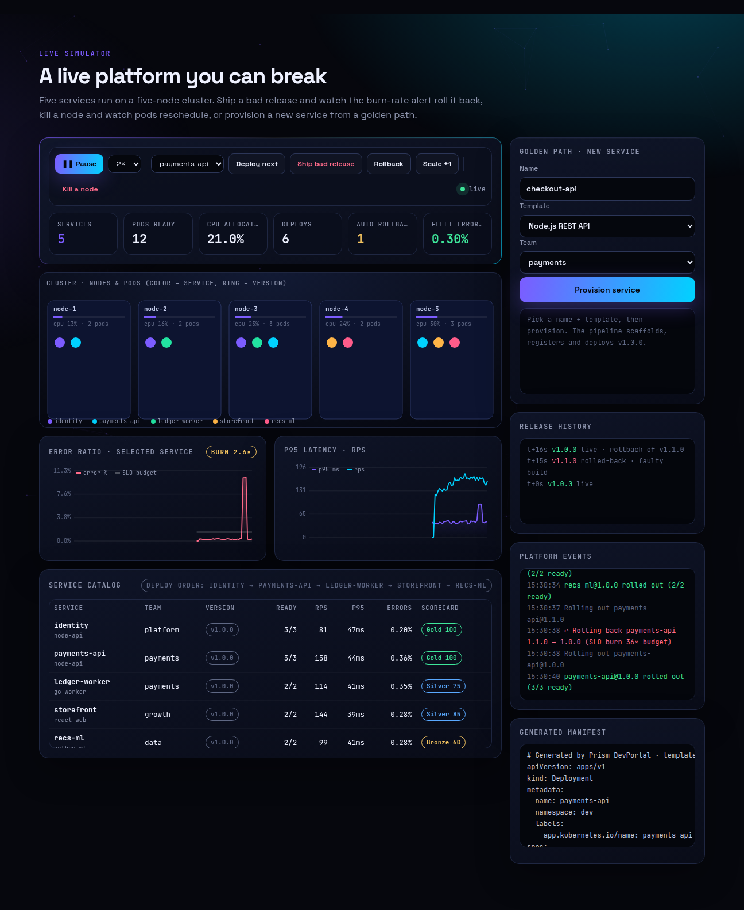
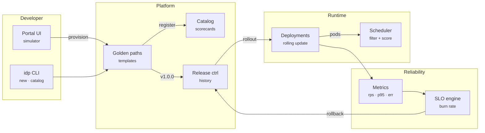
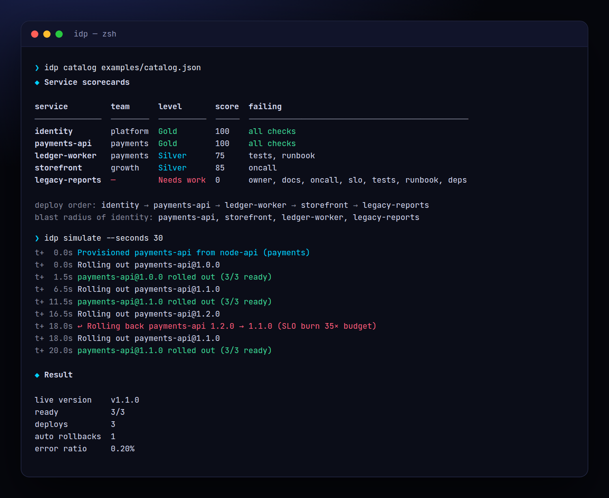
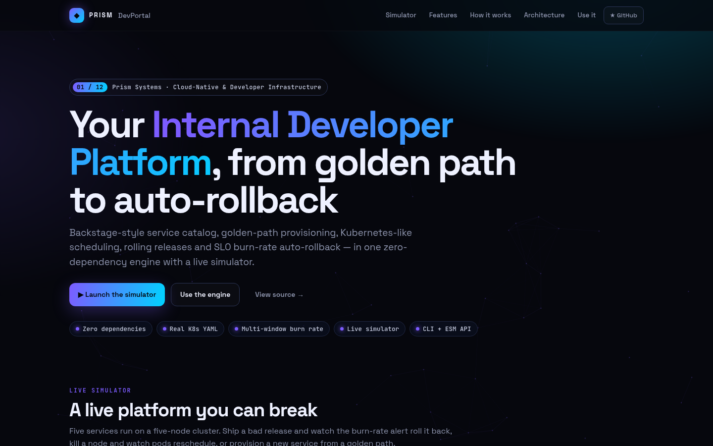
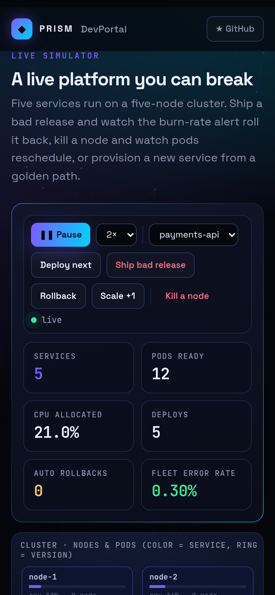

<!-- Prism Systems 01/12 -->
<p align="center">
  
</p>

<p align="center">
  
</p>

<p align="center">
  <a href="https://github.com/krishyaa06/prism-devportal/actions/workflows/ci.yml"></a>
  <a href="https://krishyaa06.github.io/prism-devportal/"></a>
  
  
  
  <a href="LICENSE"></a>
</p>

<p align="center">
  <a href="https://krishyaa06.github.io/prism-devportal/"><b>Live simulator</b></a> ·
  <a href="docs/ARCHITECTURE.md"><b>Architecture</b></a> ·
  <a href="docs/USAGE.md"><b>Docs</b></a> ·
  <a href="#-quick-start"><b>Quick start</b></a>
</p>

<p align="center">
  <a href="https://krishyaa06.github.io/prism-devportal/"></a>
</p>


## ⚡ Overview

Platform teams spend months wiring a portal, templates, deploy pipelines and SLO alerting together. Prism DevPortal models that whole loop as one small, readable engine. The catalog knows who owns what and what depends on what. Golden paths turn a name into real Kubernetes YAML. A scheduler and rolling-update controller behave like their Kubernetes counterparts. An SLO engine watches every release and rolls it back when the error budget burns too fast.

## ✨ Features

| | Feature | Details |
| :-: | --- | --- |
| ◈ | **Service catalog** | Owners, dependencies, deploy order (topological sort with cycle detection) and **blast radius** for any service. |
| ★ | **Maturity scorecards** | Seven weighted checks (owner, docs, on-call, SLO, coverage, runbook, deps) roll up to Gold / Silver / Bronze. |
| ⚡ | **Golden-path templates** | Node API, React web, Go worker and Python ML templates render a real `Deployment`, `Service`, `HPA` and `PodDisruptionBudget`. |
| ▦ | **Kube-style scheduler** | Filter nodes that fit CPU/memory, then score by least-allocated plus anti-affinity spread. Pending pods retry every tick. |
| ⟳ | **Rolling updates** | A reconcile loop honours `maxSurge` and `maxUnavailable`, so availability never drops below the replica target. |
| ↩ | **SLO auto-rollback** | Multi-window burn-rate alerting (SRE workbook, 14.4× threshold) rolls back to the last healthy revision automatically. |
| ✚ | **Self-healing** | Kill a node: its pods are evicted, rescheduled onto healthy nodes and the event stream records every step. |
| ⌘ | **CLI included** | `idp new`, `idp catalog`, `idp templates` and `idp simulate` give you the same engine from the terminal. |

## 🏗️ Architecture



### How it works

1. **Provision** — A golden path validates the DNS-1123 name, scaffolds the template, registers the service in the catalog and deploys `v1.0.0` to dev.
2. **Schedule** — Each replica becomes a pod. The scheduler filters nodes by free CPU/memory and scores them to spread one app across nodes.
3. **Release** — A new version triggers a rolling update: surge one new pod, wait for readiness, retire one old pod, repeat.
4. **Observe** — Traffic generates RPS, p95 latency and error ratio per service. Burn rate = error ratio ÷ error budget, checked on fast and slow windows.
5. **Roll back** — When both windows burn hot on a release, the platform rolls back to the last healthy revision and records it in release history.

More detail in [docs/ARCHITECTURE.md](docs/ARCHITECTURE.md).

## 🚀 Quick Start

**Try it in the browser:** [https://krishyaa06.github.io/prism-devportal/](https://krishyaa06.github.io/prism-devportal/), no install needed.

```bash
# CLI, no install
npx github:krishyaa06/prism-devportal --help

# add the engine to a project
npm install github:krishyaa06/prism-devportal
```

### JavaScript API

```js
import { Platform, manifests } from "prism-devportal";

const p = new Platform({ nodes: 4 });
p.on((e) => console.log(e.type, e.msg));

// golden path: catalog + manifests + v1.0.0
const { steps, manifests: yaml } = p.provision({
  name: "payments-api", template: "node-api", team: "payments", oncall: true,
});

for (let i = 0; i < 10; i++) p.tick(0.5);   // pods become Ready
p.release("payments-api", "1.1.0");           // rolling update
p.release("payments-api", null, { faulty: true }); // bad build…
for (let i = 0; i < 40; i++) p.tick(0.5);   // …SLO burn → auto-rollback

console.log(p.snapshot()[0].version, p.stats.rollbacks); // 1.1.0 1
```

| Export | What it does |
|---|---|
| `new Platform({ nodes, seed, autoRollback })` | Full platform: catalog + cluster + releases + SLO |
| `platform.provision({ name, template, team, deps, ...checks })` | Golden path; returns `{ steps, manifests }` |
| `platform.release(name, version?, { faulty })` | Rolling update (version auto-bumps minor) |
| `platform.rollback(name, reason)` | Roll back to last healthy revision |
| `platform.tick(dt)` | Advance simulated time (seconds) |
| `platform.snapshot()` | Per-service version, readiness, rps, p95, error ratio, scorecard |
| `new Cluster({ nodes, cpu, mem })` / `Deployment` | Scheduler and rolling-update controller on their own |
| `new Catalog()` · `order()` · `blastRadius(name)` | Dependency graph |
| `scorecard(service)` | `{ score, level, results }` |
| `manifests(opts)` / `catalogInfo(opts)` | Kubernetes YAML / Backstage `catalog-info.yaml` |
| `burnRate(errRatio, slo)` · `burnAlert(samples, slo)` · `errorBudget(slo)` | SLO math |

### CLI

```bash
$ npx github:krishyaa06/prism-devportal templates
$ npx github:krishyaa06/prism-devportal new orders --template go-worker --team payments > orders.yaml
$ npx github:krishyaa06/prism-devportal catalog examples/catalog.json
$ npx github:krishyaa06/prism-devportal simulate --seconds 40
```

<p align="center"></p>

| Command | Description |
|---|---|
| `idp templates` | List golden-path templates |
| `idp new <name> [--template] [--team] [--env]` | Print Kubernetes manifests + `catalog-info.yaml` |
| `idp catalog <file.json>` | Scorecards, deploy order and blast radius |
| `idp simulate [--seconds 40]` | Scripted good deploy → bad deploy → auto-rollback timeline |

## 📸 Screenshots

<table>
  <tr>
    <td width="68%"></td>
    <td width="32%"></td>
  </tr>
</table>

## 🧠 Design Decisions

- **Reconcile loops, not scripts.** Like Kubernetes controllers, `Deployment.reconcile()` compares desired vs. actual state every tick, so node failures and rollbacks need no special code paths.
- **Scheduler = filter + score.** Filtering drops nodes without CPU/memory headroom. Scoring favours least-allocated nodes and penalises co-locating replicas of the same app (soft anti-affinity).
- **Burn rate over thresholds.** A raw error-rate threshold either pages too often or too late. Multi-window burn rate (fast 3 samples, slow 8 samples, 14.4× budget) catches bad releases in seconds and ignores single spikes.
- **Rollback target = last healthy revision**, skipping revisions that were themselves rolled back or flagged faulty.
- **Deterministic.** Traffic noise uses a seeded PRNG, so tests and the CLI timeline are reproducible.

## 🏭 Production Notes

This repository is a faithful, runnable model of an IDP, not a replacement for a production cluster. To run it for real:

- Apply the YAML from `idp new` with `kubectl apply -f`. It is valid `apps/v1`, `autoscaling/v2` and `policy/v1`.
- Swap `Cluster` for the Kubernetes API (client-go or `@kubernetes/client-node`) and read readiness from pod conditions.
- Feed `burnAlert()` from Prometheus (`sum(rate(http_requests_total{code=~"5.."}[5m])) / sum(rate(http_requests_total[5m]))`).
- Trigger `rollback()` from Argo Rollouts / Flux, or call `kubectl rollout undo`.
- Export the catalog as Backstage `catalog-info.yaml` with `catalogInfo()`.

## 📁 Project Structure

```text
prism-devportal/
├── assets/
│   └── logo.svg
├── bin/
│   └── idp.js
├── css/
│   └── app.css
├── docs/
│   ├── ARCHITECTURE.md
│   └── USAGE.md
├── examples/
│   └── catalog.json
├── js/
│   └── app.js
├── src/
│   ├── lib/
│   │   ├── cli.js
│   │   └── rng.js
│   ├── catalog.js
│   ├── cluster.js
│   ├── index.js
│   ├── platform.js
│   ├── slo.js
│   └── templates.js
├── test/
│   └── devportal.test.js
├── .gitignore
├── LICENSE
├── README.md
├── index.html
└── package.json
```

## 🧪 Tests

```bash
npm test
```

The test suite uses the built-in `node:test` runner, so there is nothing to install. CI runs it on Node 20 and 22.

## 🗺️ Roadmap

- [ ] Canary + blue/green strategies next to rolling
- [ ] Cost estimation per service from resource requests
- [ ] Import an existing Backstage catalog
- [ ] Prometheus remote-read adapter for real SLO data

## 🤝 Contributing

1. Fork the repo and create a branch: `git checkout -b feat/my-idea`
2. Make your change in `src/` and add a test in `test/`
3. Run `npm test`, then open a Pull Request

## 🔷 Part of Prism Systems

**Prism DevPortal** is system **01 of 12** in **Prism Systems**, a series of open-source reference implementations of large-scale infrastructure by [Prism Protocol](https://dc.gg/prismprotocol). Each one ships a real engine, a CLI and a live simulator, all with zero dependencies.

## 👤 Author

<table>
  <tr>
    <td align="center">
      <a href="https://github.com/krishyaa06"><br><b>Soumya Bhandare</b></a><br>
      <sub>Founder @ Prism Protocol</sub>
    </td>
    <td>
      <a href="https://dc.gg/prismprotocol"></a><br>
      <a href="https://instagram.com/prism_protocol_"></a><br>
      <a href="https://x.com/krishyaa06"></a>
    </td>
  </tr>
</table>

## 📄 License

Released under the [MIT License](LICENSE).

<p align="center">
  <b>If this helped you learn something, consider giving it a ⭐</b><br>
  <sub>"Build. Create. Compete." · Made with ⚡ by Prism Protocol</sub>
</p>


