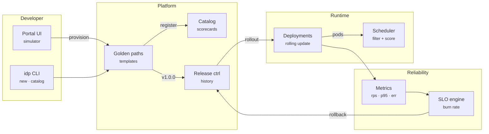

# Prism DevPortal — Architecture

Platform teams spend months wiring a portal, templates, deploy pipelines and SLO alerting together. Prism DevPortal models that whole loop as one small, readable engine. The catalog knows who owns what and what depends on what. Golden paths turn a name into real Kubernetes YAML. A scheduler and rolling-update controller behave like their Kubernetes counterparts. An SLO engine watches every release and rolls it back when the error budget burns too fast.

## System diagram

## How it works

1. **Provision** — A golden path validates the DNS-1123 name, scaffolds the template, registers the service in the catalog and deploys `v1.0.0` to dev.
2. **Schedule** — Each replica becomes a pod. The scheduler filters nodes by free CPU/memory and scores them to spread one app across nodes.
3. **Release** — A new version triggers a rolling update: surge one new pod, wait for readiness, retire one old pod, repeat.
4. **Observe** — Traffic generates RPS, p95 latency and error ratio per service. Burn rate = error ratio ÷ error budget, checked on fast and slow windows.
5. **Roll back** — When both windows burn hot on a release, the platform rolls back to the last healthy revision and records it in release history.

## Design decisions

- **Reconcile loops, not scripts.** Like Kubernetes controllers, `Deployment.reconcile()` compares desired vs. actual state every tick, so node failures and rollbacks need no special code paths.
- **Scheduler = filter + score.** Filtering drops nodes without CPU/memory headroom. Scoring favours least-allocated nodes and penalises co-locating replicas of the same app (soft anti-affinity).
- **Burn rate over thresholds.** A raw error-rate threshold either pages too often or too late. Multi-window burn rate (fast 3 samples, slow 8 samples, 14.4× budget) catches bad releases in seconds and ignores single spikes.
- **Rollback target = last healthy revision**, skipping revisions that were themselves rolled back or flagged faulty.
- **Deterministic.** Traffic noise uses a seeded PRNG, so tests and the CLI timeline are reproducible.

## Production notes

This repository is a faithful, runnable model of an IDP, not a replacement for a production cluster. To run it for real:

- Apply the YAML from `idp new` with `kubectl apply -f`. It is valid `apps/v1`, `autoscaling/v2` and `policy/v1`.
- Swap `Cluster` for the Kubernetes API (client-go or `@kubernetes/client-node`) and read readiness from pod conditions.
- Feed `burnAlert()` from Prometheus (`sum(rate(http_requests_total{code=~"5.."}[5m])) / sum(rate(http_requests_total[5m]))`).
- Trigger `rollback()` from Argo Rollouts / Flux, or call `kubectl rollout undo`.
- Export the catalog as Backstage `catalog-info.yaml` with `catalogInfo()`.
